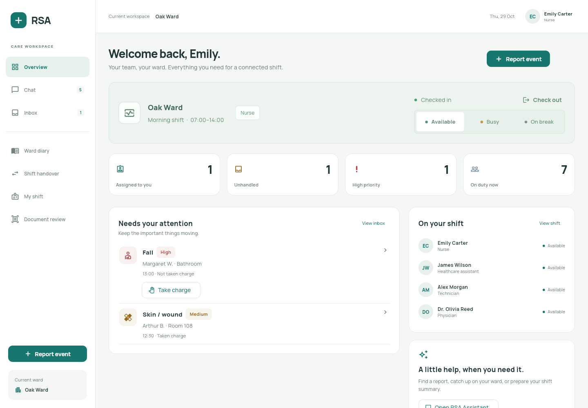

# RSA

A phone-first Flutter care coordination prototype for Android, iOS, and the web. One shared repository connects reporting, routing, responsibility, chat, the ward diary, and shift handovers. All people, residents, messages, and care records are fictional.

**Synthetic data only.** This frontend is not configured for real health data. Authorization and audit behavior demonstrate a workflow; client-side checks and local SQLite are not production security boundaries.

## Run

Tested with **Flutter 3.47.8 / Dart 3.13.7**. Dependencies are pinned in `pubspec.lock`; use the compatible stable SDK and retain the lockfile.

```sh
flutter pub get
flutter gen-l10n
flutter devices
flutter run -d chrome
# Android/iOS device or emulator listed by flutter devices:
flutter run -d <device_id>
```

Flutter supports hot reload on the available development target. In this cloud machine, first run `source tool/cloud_env.sh` from the existing `/workspace/RSAprototype_2` checkout. It activates the installed SDK, writable caches, and Chromium. Use `flutter run -d chrome --web-browser-flag=--no-sandbox` where the container requires it, or `flutter run -d web-server --web-hostname=0.0.0.0 --web-port=8080` for the development server. Do not create another worktree: each cloud task already has an isolated checkout.

For the complete offline-capable web build:

```sh
./tool/build_web.sh
python3 tool/serve_web.py --port 8080
```

The server provides SQLite WASM MIME types and cross-origin isolation headers. Stop the development server before using the same port for a release build. Standard Flutter development serving does not generate the release app-shell cache.

Android needs an Android SDK, Java, and a device/emulator; the app sets a minimum API of at least 23. iOS needs macOS, Xcode, and the relevant simulator/device SDKs. Physical-device signing and the final application identifier require local configuration. Camera and microphone permission descriptions are included in both platform projects. Native capture, TalkBack, VoiceOver, and app lifecycle behavior still require device validation.

## Access and logout

A fresh application load opens the public **Login** page. Click **Login** with both fields empty to enter as **Emily Carter, Nurse, Oak Ward**. This is the temporary frontend entry requested for reviewing the app; credentials are not checked and no identity provider is contacted.

There is no self-service registration. User accounts are added manually in the database. Credential validation and persistent sessions will be connected to the backend; old `/register` links return to Login.

Use the profile avatar/name at the top right to open Account settings. **Log out** asks for confirmation, clears the frontend navigation session and returns to Login. Cancelling keeps the workspace open. Internal URLs and browser Back cannot display protected pages while signed out. Clinical records and saved work remain in the local database. The frontend session is in memory, so a full reload starts at Login again.

Conversation routes open without a page transition. A reversed message viewport renders the newest messages at the bottom on the first frame, avoiding a visible initial jump; chronological reading order is preserved.

## Account and development fixtures

The standard interface shows operational controls without demo badges, a connection badge, or persona-switching tools. The Home shift card shows the current ward, shift hours, professional role, check-in/out and availability. The sidebar identifies the current ward without a slogan or placeholder image. Open the profile avatar for account details and assigned-ward selection.

Synthetic fixtures still back the frontend until the real backend is connected. Development utilities are excluded from normal navigation and blocked by the default route guard. To intentionally enable persona switching, time advancement, connectivity simulation, reset, and sample-media capture during development, launch:

```sh
flutter run -d chrome --dart-define=RSA_DEVELOPMENT_TOOLS=true
```

Open **Development tools** in that explicitly enabled desktop build (or navigate to `/development`). These tools are not authentication and should not be enabled for the deployed staff interface. The role examples and walkthrough below refer to this development-only mode. All seven professional interfaces are capability-based; the official interface does not allow an account to grant itself another identity or role. Corporate SSO/MFA and the authenticated session will be supplied by the backend. See [role interfaces](docs/ROLE_INTERFACES.md).

| Persona | What to try |
| --- | --- |
| Emily Carter — nurse | Take charge of an alert, close it with an outcome, change attendance/availability. |
| James Wilson — healthcare assistant | Report a Fall; follow the same event through its diary and conversation. |
| Alex Morgan — technician | Report a Safety item; care access does not grant nursing responsibility. |
| Dr. Olivia Reed — physician | Validate reviewed clinical handover content; cannot sign as coordinator. |
| Sarah Mitchell — coordinator | Manage ward attendance and skills, review/sign outgoing handovers. |
| Daniel Brooks — medical management | Filter aggregate operations by ward/date; no clinical records or chats. |
| Taylor Quinn — system administrator | Edit account/ward-role metadata; inspect integrations, routing and audit metadata. |
| Mia Thompson / Noah Parker / Amelia Hayes | Compare off-duty, busy, and on-break nursing eligibility. |
| Lucas Bennett — Willow nurse | Inspect the separate Willow Ward scope and incoming acknowledgement. |

The initial Oak handover is signed and awaits assigned incoming staff acknowledgement. Emily can acknowledge that version. The handover workspace includes a shift transition banner, lifecycle, open priority alerts, an editable source-based draft, linked reports, contributions and incoming team. Coordinators review/sign and create amendments; physicians validate when required. Signed narrative and source snapshots are preserved. Creating a new source after signature preserves the signed version and starts an amendment requiring renewed review/signature. See [handover workflow](docs/HANDOVER.md).

Suggested connected flow:

1. As James, open **Report event**, select a resident, and send a Fall. Notes, voice and photo are optional.
2. As Emily, find the same item in **Inbox**. Opening its conversation does not claim it. Choose **Take charge**, then close it with an outcome if appropriate.
3. Find the original report and amendments in **Ward diary** and the source links in **Shift handover**.
4. Contribute a summary; switch to Sarah to review and sign. If clinical validation is required, Olivia must validate the reviewed version first. An assigned incoming staff member acknowledges explicitly.
5. Switch the demo offline and report again: it remains queued, with no staff notification. Reconnect to synchronize the same event once.
6. Open **Conversations** for ward, direct and private **RSA Assistant** conversations. Use **+** to find a colleague and create or reuse a direct conversation. Event discussions enter each account’s list only after **Open chat** from that event; this preference survives reopening and does not change ward authorization. Human messages become events only after reviewing and submitting a draft. Assistant answers link current authorized records.

High routes to on-duty qualified nurses and present coordinators, including busy staff; off-duty and on-break staff are excluded. Medium initially targets available qualified nurses quietly. Low creates no targeted alert. Unhandled items remain visible when coverage is missing. Demo deadlines are **High: 2 minutes; Medium reminder: 5 minutes; Medium escalation: 10 minutes**. These are demonstration assumptions, not approved clinical policy. **Advance time** evaluates them without waiting; resume also evaluates persisted deadlines. Production scheduling belongs on the backend.

## Storage, offline behavior, and media

Drift uses native SQLite through an isolated native executor, and SQLite WASM plus a Drift worker on web. The shared repository serializes transactions, stores unique event keys and claims, and retains a durable snapshot of records, drafts, outbox, versions, and media bytes. It emits Riverpod/stream updates. No Drift row code generation is needed; the database uses explicit custom SQL. `flutter gen-l10n` generates localization accessors.

Web selects a supported durable browser storage mode. An in-memory-only result produces a visible startup error instead of silently claiming saved data. Browser site-data clearing removes the synthetic demo; storage availability and eviction remain browser dependent. **Use one writing tab.** SQLite uniqueness is demonstrated within one repository; independent snapshot writers are not a production multi-tab collaboration system. No cross-device synchronization is implemented.

`tool/build_web.sh` builds with local engine/font assets and generates a versioned, explicit static-asset service worker. It caches the app shell, fonts, engine and required SQLite assets only; it does not indiscriminately cache API responses or protected media. Offline reopening requires a completed first online load and service-worker installation on a supported secure origin. Queue persistence is independent of the worker. Rebuilding changes the cache version; updates activate after installation. Development-mode refresh is different from a verified release offline reopening.

The demo connectivity switch controls delivery simulation; it does not prove remote service reachability. Queued is never delivered. Original occurrence, registration and synchronization timestamps are distinct UTC instants. Display and morning/afternoon/night boundaries use `timezone` IANA data for **Europe/Rome**, including daylight-saving transitions.

Media capture requests permission on use. Camera preview supports retake/attach; recording supports stop/playback/discard and durable WAV bytes. No intentional gallery writes are made. If hardware or permissions are unavailable, the standard interface reports the failure and offers retry. Explicitly labeled sample-photo/tone controls are available only with development tools enabled. Document review is available from the sidebar and compact More menu. It preserves the source image, original extraction and reviewed text. Newly captured/imported documents remain awaiting extraction; manual transcription is available while the OCR service is not connected. Confirming transcription does not constitute clinical validation. Physical-device media/permission behavior has not been certified by web checks.

## Architecture and backend replacement

- `lib/app`: Material 3 theme, adaptive shell, go_router routes and guards. Persona/ward changes recreate the navigation scope.
- `lib/core/models.dart`: typed, JSON-serializable domain DTOs, ward-role assignments, capability map and timezone-aware shifts.
- `lib/core/repository.dart`: scoped demo queries/mutations, routing, escalation, messaging, source-based assistant, versions and workflow transitions.
- `lib/core/database*.dart`: conditional native/web Drift executors. `lib/core/providers.dart`: Riverpod injection point.
- `lib/core/backend.dart`: replaceable authenticated HTTPS/FastAPI contract, with idempotency and explicit error handling. It is not connected to the demo.
- `lib/core/media.dart`, `lib/shared/media_capture.dart`: platform-compatible capture, playback and durable payloads.
- `lib/features`: connected screens. `lib/shared`: reusable components. `lib/l10n`: ARB resources and generated Flutter localization delegates.

English is fixed initially, including Flutter dialogs. `app_it.arb` is an English fallback scaffold awaiting translation; it does not introduce mixed-language UI. Dynamic seeded content remains English. The resource helper reads the same ARB keys used by `flutter gen-l10n`.

To connect FastAPI, replace the demo repository provider with authenticated HTTP/realtime adapters and agree the example JSON contracts in `backend.dart` with the server. Resolve users, ward capabilities, recipient eligibility, idempotency and claims on the server for every operation. Move LangGraph, OCR/transcription, escalation scheduling, and model-provider calls behind that authenticated backend. Use PostgreSQL, protected object storage and a separate protected audit store as planned. Do not put model-provider credentials or agent runtimes in Flutter.

## Verification

```sh
flutter gen-l10n
dart format --output=none --set-exit-if-changed lib test integration_test test_driver
flutter analyze
flutter test
./tool/build_web.sh
# With the Android toolchain available:
flutter build apk --debug
# On macOS with Xcode:
flutter build ios --simulator --debug
```

Browser integration, using a matching ChromeDriver on port 4444:

```sh
chromedriver --port=4444
flutter drive --driver=test_driver/integration_test.dart \
  --target=integration_test/workflow_test.dart -d web-server \
  --chrome-binary=/path/to/chrome --headless
```

In the cloud, Chromium is `/usr/bin/chromium`; add `--web-browser-flag=--no-sandbox --web-browser-flag=--disable-dev-shm-usage`. The isolated integration browser resets synthetic data in its own origin/profile. Unit/widget tests use an independent database. The cloud verification passed **109 unit/widget tests**, the browser integration flow, the release build and offline-reopening smoke check. See [verification results](docs/VERIFICATION.md) for actual outcomes, and [scope checklist](docs/CHECKLIST.md) for limitations.

## Prototype boundaries

SSO/MFA, remote push, backend, LangGraph, real OCR/transcription, and clinical-system integrations are **not connected**. Assistant outputs are deterministic retrieval/summaries of current authorized demo records; no diagnosis, treatment advice or clinical risk scoring is generated. Integration status never claims successful external authentication.

The synthetic attendance model tracks per-person presence/availability, not concurrent independent duty ledgers across wards. Role assignments support explicit multiple roles scoped per ward; administrators receive no automatic clinical capability. Resident lists are ward-assigned demo subsets, not a full EMR or a production rostering system.

Messages/media and versions are retained without staff deletion controls; fingerprints and append-only demo logs illustrate traceability, not tamper-proof retention or a complete production access audit. Ordinary SQLite, browser storage and app-private files are not encrypted by this prototype. Retention expiry, protected offline credentials/media, secure erasure, EU hosting, DPIA/vendor controls, intended-use review, push reliability, native capture/location-metadata stripping and accessibility on real devices require production work.

Backlog: FHIR connectors; no-code routing editor; forecasting/advanced workload analytics; self-hosted models; advanced DPO retention search/export; real multi-user realtime delivery; policy-approved retention and timeouts. No GDPR certification, medical-device clearance, or qualified signature/preservation claims are made.

## Screenshots

[Login desktop](docs/screenshots/login-desktop.png) · [Login phone](docs/screenshots/login-mobile.png) · [Account/logout](docs/screenshots/account-desktop.png)



Workspace screenshots: [Handover desktop](docs/screenshots/handover-desktop.png) · [Report cards](docs/screenshots/handover-record-desktop.png) · [Version history](docs/screenshots/handover-history-desktop.png) · [Document review](docs/screenshots/documents-desktop.png) · [Conversations](docs/screenshots/conversations-desktop.png).

Phone screenshots: [Handover](docs/screenshots/handover-mobile.png) · [Home](docs/screenshots/home-mobile.png) · [Rapid reporting](docs/screenshots/report-mobile.png).

The handover record now uses color-coded report cards and a grouped version timeline. Staff can send post-signature updates for coordinator review; the signed document remains unchanged until a coordinator includes those updates in a new draft version. See [handover workflow](docs/HANDOVER.md).
